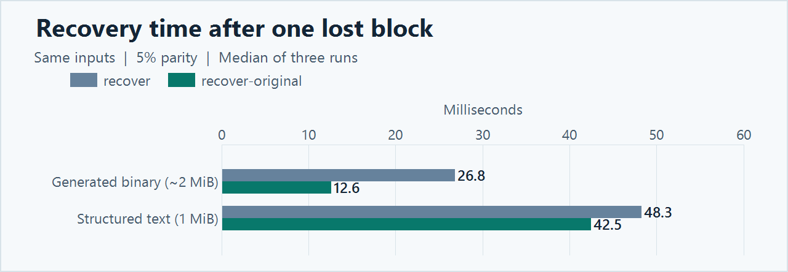
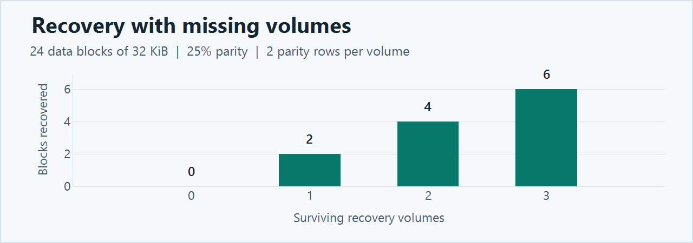

# Performance

The CLI and codec run in Rust. Global16 uses the same GF16 multiply-and-accumulate kernel as the previous native addon, with file-backed batches and an 8 MiB output budget. Full recovery stages and verifies the original, inner recipe, and regenerated protected archive. DEFLATE uses the Rust `zlib-rs` backend. [DEFLATE backend](https://github.com/rust-lang/flate2-rs#implementation)

## Damage to both inputs

The demo uses a 1 MiB generated binary file split into 32 blocks of 32 KiB. At 50% parity, the archive has 16 parity rows. The main case zeroes 24 original blocks and removes 24 recipe data frames. The removed frames account for 789,288 of the 1,588,546 archive bytes (49.7%). The catalog and all parity rows survive. GRFP re-encodes eight recipe blocks from surviving original data, retains eight recipe blocks already in the archive, and decodes the 16 shared gaps from parity. All three outputs match their undamaged counterparts byte for byte.

| Original zeroed | Recipe data blocks erased | Blocks missing from both | Surviving parity rows | Result |
| ---: | ---: | ---: | ---: | --- |
| 75% | 75% | 16 | 16 | Exact recovery |
| 75% | 75% | 17 | 16 | Insufficient parity |
| 75% | 75% | 16 | 15 | Insufficient parity |
| 50% | 100% | 16 | 16 | Exact recovery |
| 100% | 50% | 16 | 16 | Exact recovery |

The table below uses the smallest possible overlap for each equal-loss case. With `e` blocks erased on each side, at least `max(0, 2e − 32)` blocks will be missing from both. Each run retained the catalog and all parity rows. For every setting below 100% parity, erasing one more block on both sides exceeded the available parity.

| Parity setting | Parity rows | Largest equal loss recovered per input |
| ---: | ---: | ---: |
| 0% | 0 | 16 / 32 (50%) |
| 5% | 2 | 17 / 32 (53.1%) |
| 25% | 8 | 20 / 32 (62.5%) |
| 50% | 16 | 24 / 32 (75%) |
| 75% | 24 | 28 / 32 (87.5%) |
| 100% | 32 | 32 / 32 (100%) |

The fixture concatenates the SHA-256 digests of consecutive 32-bit little-endian counters from 0 through 32,767. Its SHA-256 is `f443f5f87314e70000f7cc4715f041d19ba44748d0f705839735ed4cd7c1383c`. For the 50% demo, zero original blocks 9 through 32 in `damaged.bin` and erase recipe data frames 1 through 24 in `damaged.grfp`, counting the first recipe block as 1. Restore original block 25 and zero block 8 for the 17-overlap case.

```sh
grfp pack source.bin archive.grfp --text off --block-size 32KiB --parity 50
grfp recover damaged.grfp recovered --damaged damaged.bin
```

Exact recipe reconstruction from a surviving original block requires a matching encoded checksum. These tests use the same Rust encoder profile for packing and recovery. [Frame layout](format.md#catalog-and-inner-recipe)

## Matched workloads

Medians of three runs on Windows x64 with an Intel Core i7-14700. The previous Node measurements used Node 22.16.0. The Rust executable was built in release mode with Rust 1.96.0.

| Workload | Node JavaScript | Standalone Rust |
| --- | ---: | ---: |
| Encode 20 parity rows from 384 shards, up to 88 KiB each | 405.4 ms | 122.3 ms |
| Recover 8 erased shards from the same input | 166.4 ms | 51.2 ms |
| Pack about 2 MiB of generated binary data, 5% parity | 219.3 ms | 135.1 ms |
| Recover binary after deleting one recipe frame | 28.7 ms | 23.6 ms |
| Pack 1 MiB of structured text, 5% parity | 368.9 ms | 180.3 ms |
| Recover text after deleting one recipe frame | 93.9 ms | 46.8 ms |

The benchmark checks the GF16 parity SHA-256 against the Node reference and compares every recovered shard with its original. The archive cases verify the restored original and regenerated archive. Their source distributions, encoder settings, and erasure positions match the previous Node benchmark. [Benchmark](../examples/benchmark.rs)

## Original-only recovery

Medians of three matched Rust release runs on the same machine with 5% parity and one missing recipe frame per archive. Both commands restored the original byte for byte.

| Workload | `recover` | `recover-original` |
| --- | ---: | ---: |
| About 2 MiB of generated binary data | 26.8 ms | 12.6 ms |
| 1 MiB of structured text | 48.3 ms | 42.5 ms |



`recover-original` verifies the original as it writes it and skips generating the inner recipe and protected archive. Timings vary with the input, parity budget, CPU, and filesystem.

```sh
cargo run --release --locked --example benchmark
```

## Recovery with missing volumes

The test packed 768 KiB of generated binary data into 24 data blocks of 32 KiB each. At 25% parity, three volumes held two parity rows apiece. The primary catalog stayed readable while the first recipe blocks were erased.

| Surviving volumes | Missing data blocks recovered | Volume selections tested |
| ---: | ---: | ---: |
| 0 | 0 | 1 |
| 1 | 2 | 3 |
| 2 | 4 | 3 |
| 3 | 6 | 1 |



For every selection, `recover-original` reproduced the source byte for byte at the reported erasure count. Erasing one more block exhausted the surviving parity and left no output file. [Frame layout](format.md#separate-recovery-volumes)

The compatibility suite also verifies exact recovery of Node-written global16 archives, including the published Regrow-8 CPU and ALU. Fresh DEFLATE streams may differ between encoder implementations. Exact reconstruction of a missing wire from source bytes therefore requires a matching wire checksum. Parity recovery uses the original wire data and preserves its bytes.
